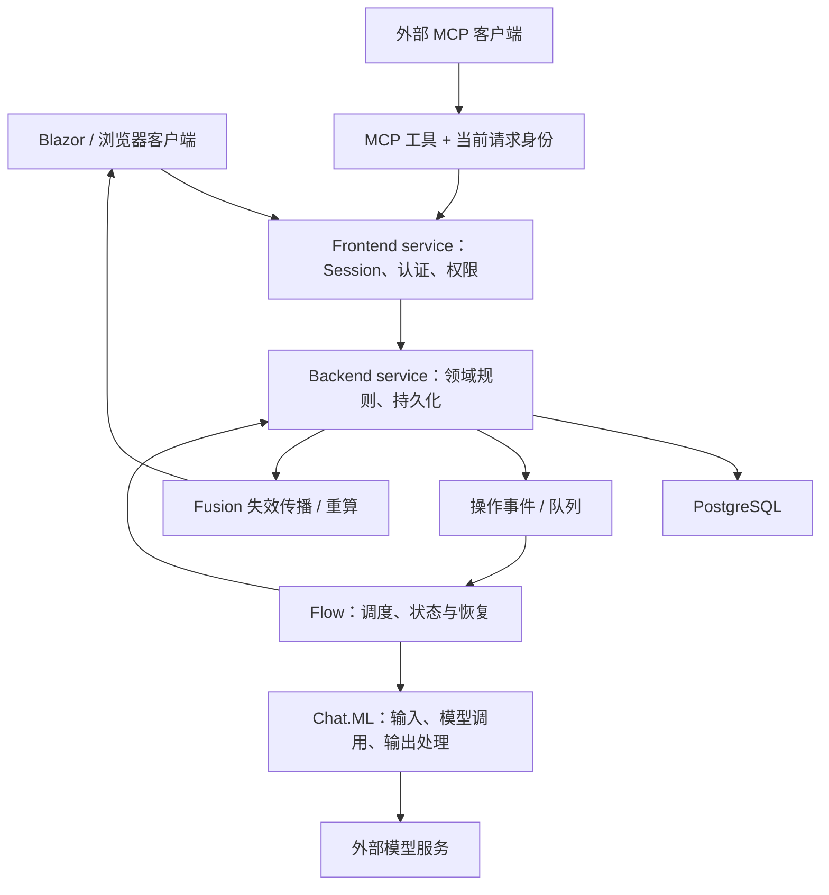

# 第 1 课：先认识产品架构，再定位 AI

## 这一课的目标

把仓库理解为一个真实通信系统，找到 AI 的位置。无需先读完所有服务，也无需从头学习音视频协议。

源码与文档入口：

- [根 README](../../../README.md)
- [项目目录说明](../../../docs/architecture/project-structure.md)
- [整体架构](../../../docs/architecture/overview.md)
- [精简类型索引](../../../docs/api-index.md)

## 1. 先建立目录地图

| 目录 / 项目 | 职责 | 现在的阅读优先级 |
|---|---|---|
| `src/dotnet/App.Server` | 服务端宿主、启动与模块装配 | 理解入口，暂不深入部署 |
| `Api.Contracts`、各领域 `*.Contracts` | 接口、命令、共享模型 | 高 |
| `Chat.Service`、`Users.Service` 等 | 权限入口、业务规则、数据库操作 | 高，按功能定位 |
| `Chat.ML` | 摘要、文本格式化、语音标注等模型相关逻辑 | 最高 |
| `Core.Server/Flows`、`Flows.Service` | 通用 Flow 抽象、运行与持久化 | 第 3 课 |
| `Mcp` | 面向外部 Agent / MCP 客户端的工具服务 | 第 4 课 |
| `MLSearch.Service` | 索引、检索与结果处理 | 工具检索路径需要时再读 |
| `UI.Blazor.App`、`src/nodejs` | UI、浏览器集成与共享 TypeScript | 先掌握状态如何到 UI |
| `tests` | 单元、集成、浏览器及其他测试 | 与对应功能一起读 |
| `.claude`、`.agents`、`.github` | 开发规则、技能、Hooks 和 CI | 第 6 课 |

本地 `global.json` 指定 .NET 11 RC SDK，`Directory.Build.props` 的非 MAUI 默认目标是 `net11.0`。这些是当前源码约束，不是对你的电脑安装状态的判断。运行前必须先核对版本，不能默认现有 .NET SDK 足够。

## 2. 读懂两层服务

这里的 **Frontend service** 是对客户端开放的业务 API 层，不是网页上的 JavaScript 文件。

这是一张职责图，不表示每个请求都会经过所有节点，也不表示所有领域数据与外部调用处在同一个事务中。

如果熟悉 PHP / Node.js：

- `Contracts` 类似接口、DTO 与应用协议。
- `Module` 的依赖注入注册类似容器装配 / composition root。
- Frontend service 类似带认证授权的应用服务；Backend 更接近内部领域服务。
- `CancellationToken` 可类比 `AbortSignal`，但要沿整条调用链传递才有意义。
- `Task<T>` 可类比返回未来结果的异步操作；`await` 本身不会让任务具备跨进程恢复能力。

## 3. Fusion 为什么重要

普通 Web 系统常见模式是“写数据库 → 手动刷新页面”。这里大量读取通过 `[ComputeMethod]` 表达，Fusion 跟踪读取之间的依赖；写操作触发失效，依赖的计算再更新。

不要把它理解为数据库一变化，所有界面就无条件自动正确。业务写入需要遵守项目的命令和失效机制；绕过它可能导致缓存与 UI 不一致。

先读 [Chats.GetRules 与读取方法](../../../src/dotnet/Chat.Service/Chats.cs)，再找 `OnUpsertEntry`（基线约第 687 行），观察入口如何接收 Session 和命令。随后在 [ChatsBackend](../../../src/dotnet/Chat.Service/ChatsBackend.cs) 搜索 `OnChatEntryChangedEvent`（约第 1719 行），只阅读这一段的事件后续。

## 4. AI 摘要从哪里被触发

`ChatsBackend.OnChatEntryChangedEvent` 中可以看到：

1. 流式条目尚未完成时，不立即进入摘要。
2. 检查摘要功能是否开启、聊天是否允许摘要。
3. 一般消息安排 `ConversationSplitFlow`。
4. 音频条目另外唤醒 `LiveConversationSummaryFlow`。
5. 删除 / 恢复条目走重新生成覆盖范围摘要的分支。

因此，“发一条普通文字消息”与“实时通话中的摘要”不是同一条完整处理路径。第 2 课先读两者共用的摘要组件，第 3 课再读实时 Flow。

## 5. 检索与 Agent 不要混淆

当前 [MLSearchServiceModule](../../../src/dotnet/MLSearch.Service/Module/MLSearchServiceModule.cs) 注册 OpenSearch，现有 [SearchBackend](../../../src/dotnet/MLSearch.Service/SearchBackend.cs) 也调用 OpenSearch。`docs/plans` 中存在 PostgreSQL 全文检索方案，并不证明替换已经实施。

有索引或 Embedding 组件，也不代表已经形成“检索 → 模型回答 → 引用检查”的完整 RAG 应用。先跟踪实际调用者再下结论。

## 理解检查

1. 为什么外部工具应复用带 Session 的服务，而不是直接访问 Backend？
2. 数据库已更新但界面未刷新时，除网络问题外还应该检查哪个机制？
3. 目录名、架构计划、实际注册代码冲突时，你如何判定当前行为？

先写自己的答案，再看 [参考答案](08-answer-notes.md)。
