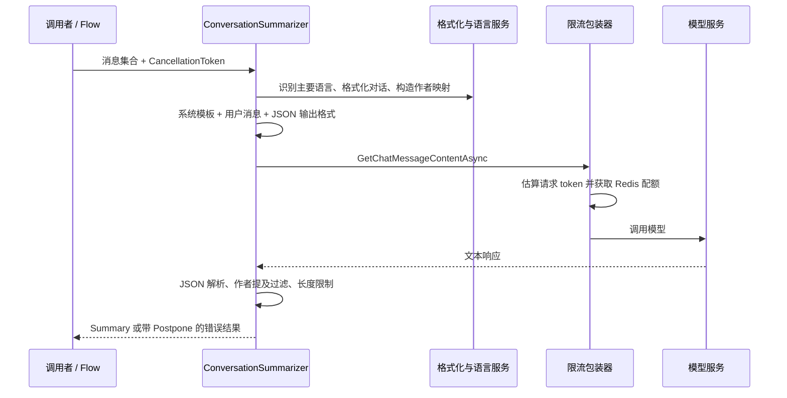

# 第 2 课：沿着一份输入读懂 AI 摘要

## 这一课的目标

理解模型调用前后发生了什么。先把“生成摘要”看成一个可替换、可验证的组件，再考虑 Agent 框架。

主入口：[ConversationSummarizer.cs](../../../src/dotnet/Chat.ML/ConversationSummarizer.cs)。
基线导航：`Summarize` 约 55 行，`SanitizeSummary` 127 行，`BuildRequest` 156 行，`CreateExecutionSettings` 279 行。

## 1. 输入和输出

`IConversationSummarizer.Summarize` 接收一组 `ChatEntrySlim` 与取消信号，返回 `ConversationSummarizerResult`。

| 对象 | 意义 |
|---|---|
| `ChatEntrySlim` | 摘要需要的消息内容、作者、顺序与时间信息 |
| `ConversationSummary` | `Title`、`Description`、`Summary` |
| `ConversationSummarizerResult` | 成功摘要，或异常及建议延后时间 `Postpone` |

不要把 `HasResult == true` 等同于内容质量合格。当前实现遇到空输出 / 解析失败时，可能返回含失败说明的 `ConversationSummary`；这仍然是非空结果。

## 2. 模型调用链



`ChatServiceModule` 的 `AddKeyedOpenAI` 装配模型客户端和限流包装器。`ConversationSummarizer.ServiceKey` 把摘要功能连接到对应服务，模型与超时从设置读取。

阅读 [模块注册](../../../src/dotnet/Chat.Service/Module/ChatServiceModule.cs) 的摘要分支及 `AddKeyedOpenAI`，再读 [限流包装器](../../../src/dotnet/Chat.ML/ChatCompletionService/RateLimitedChatCompletionService.cs)。不要只看 `new Kernel` 或 SDK 包名。

## 3. 输入整理也是工程核心

`Summarize` 先去重作者，调用 `GetMostCommonLanguage`，通过 `IChatDialogFormatter` 整理消息，再生成作者名与内部 mention ID 的映射。

语言检测会复用已有结果；未检测且包含字母的消息最多取最新 5 条补查。这里是在控制额外工作量，并不等于语义上一定最优。

`BuildRequest` 将模板渲染成 system message，将作者映射和对话放入 user message。这让指令与业务数据有明确的结构区分；但聊天内容仍可能含恶意指令，消息角色本身不是完整的提示注入防线。

**运行条件的重要缺口：** 当前 Git 跟踪文件中没有 `summarize-conversation.md`。模块通过 `CoreServerSettings.PromptsDir` 加载该模板；[CI 测试工作流](../../../.github/workflows/_run-tests.yml) 在可选步骤中从另一个 configs 仓库取得 prompts。因此本教程能分析请求组装，但不能展示或评价未提供的生产 Prompt。不要拿 `build/Commands/Prompts.cs` 当作 LLM 提示词，那是构建命令的终端交互辅助类。

## 4. 输出不是可信对象

当前实现要求 JSON 格式描述，随后仍用 `JsonDocument.Parse` 解析，读取三个字段，并调用 `SanitizeSummary`：

- 只保留输入作者集合里的 Author mention。
- 限制总提及数量。
- 对标题、描述、摘要分别限制长度。

这些是明确的应用边界。JSON Schema 能帮助结构生成，不能证明摘要内容真实、引用正确或没有遗漏。

值得进一步评估的边界：

- `Summarize` 用 `authorIds.First()`，空输入应由调用者预防，或在后续练习中明确处理；不能因为 `GetMostCommonLanguage` 支持空集合，就认为整个摘要接口支持。
- `ActivityStatusCode.Ok` 在模型响应后、完整解析前设置。模型 HTTP 成功与业务摘要成功需要分开度量。
- 解析失败返回说明性摘要，可能被上层按“有结果”处理。这是当前行为，不是已证明的生产故障。
- 429 被转换为带 `Postpone` 的结果；调用者是否遵守要继续追踪，不能在本层作保证。

## 5. 限流与成本不是一回事

[TokenEstimator](../../../src/dotnet/Chat.ML/ChatCompletionService/TokenEstimator.cs) 按空白分词数乘 2.4 粗估 token。没有空格的中文长段落可能被计为一个词，因此它不能当作精确 token 计费或上下文窗口检查器。

限流包装器在请求前获取 Redis token bucket 配额，再转发调用。当前这条路径没有展示按最终 usage 回补估算差额。练习时应分别记录请求频率、输入/输出 token、失败重试和总费用，不用一个粗估值代替全部指标。

## 练习：跟踪一份输入

使用虚构消息，不访问私人聊天：

```text
作者 A：我们周五发布搜索功能。
作者 B：发布前还要完成权限测试。
作者 A：如果权限测试未通过，就延后发布。
```

在纸上或本地笔记写出：

1. 哪些信息进入作者映射？哪些进入对话正文？
2. 期待摘要保留的三个事实是什么？
3. 如果返回“周五一定发布”，结构校验为什么不能发现问题？
4. 如果模型提及一个输入里没有的作者，哪个方法负责过滤？

这项练习无需模型账户；它先训练你识别输入、输出和可验证约束。
