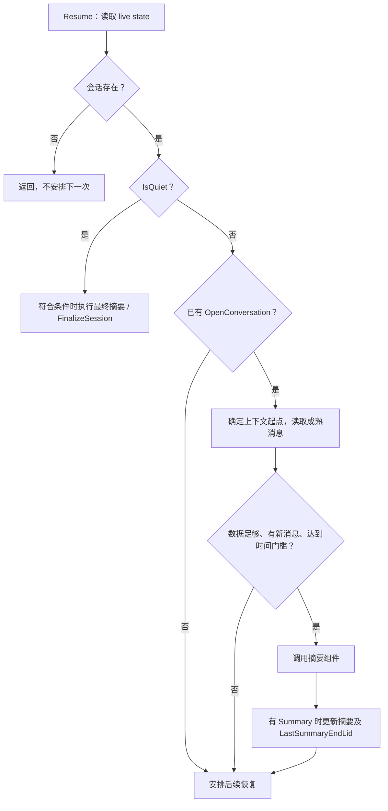

# 第 3 课：Workflow 如何保存进度与恢复

## 这一课的目标

能解释“异步执行”和“持久化流程”的差别，并找出一次失败会重复哪些步骤。

阅读入口：

- [LiveConversationSummaryFlow](../../../src/dotnet/Chat.Service/Flows/LiveConversationSummaryFlow.cs)
- [Flow](../../../src/dotnet/Core.Server/Flows/Flow.cs)
- [FlowRuntime](../../../src/dotnet/Core.Server/Flows/Infrastructure/FlowRuntime.cs)
- [FlowBackend](../../../src/dotnet/Flows.Service/FlowBackend.cs)

## 1. 从业务流程开始

`LiveConversationSummaryFlow` 继承 `Flow<Unit>`，持久化字段 `LastSummaryEndLid` 记录上次处理到的消息。`Resume` 大致做以下判断：



`Throttle` 是 15 秒，但它不是“每 15 秒一定调用模型”：消息成熟度、数量、词数、是否有新消息、重新摘要间隔都可能阻止调用。

注意：没有 live state 时普通 `return` 不等于设置完成结果。判断 Flow 是否完成，应看 `UntypedResult` / `SetResult` 等机制，而不是只读调用者附近的注释。

## 2. 状态、行为与调度分离

| 层 | 负责什么 |
|---|---|
| 具体 Flow | 业务决策、进度字段、下一步何时发生 |
| `Flow` | 初始化、恢复入口、可选 inbox、成功返回后的自动提交 |
| `FlowRuntime` | 收集待发事件、inbox 差异，构造 `Flows_Store` |
| `FlowBackend` | 加载状态、版本检查、数据库写入、恢复重试 |

基线导航：`Flow.HandleResume` 约 102 行；`FlowRuntime.Commit` 49 行；`FlowBackend.OnResume` 202 行；`OnStore` 243 行。

`OnResume` 使用每个 FlowId 的锁，并通过当前持久化状态创建或克隆 Flow。`Resume` 正常完成后，默认自动提交。持久化并没有把 C# 调用栈保存下来：恢复时重新执行方法，依靠保存的字段决定下一步。

## 3. 为什么提交事件和状态要放在一起

假设先更新“已处理到 100”，却在安排下一轮前崩溃：流程可能停止推进。反过来，先发下一轮事件，却没保存进度：下一轮可能重复处理。

`FlowRuntime.Commit` 把 Flow、待发事件与 inbox diff 一起交给 `Flows_Store`。`FlowBackend.OnStore` 在操作数据库上下文中写状态、处理 inbox 变化并登记事件；事件由项目操作机制继续提交。

版本号防止旧状态覆盖新状态。涉及 inbox 差异的冲突需要重新恢复，不能假装已经消费消息。

**边界：** 这些机制覆盖参与本次持久化操作的数据，不能回滚已发送到模型服务的 HTTP 请求，也不能自动回滚另一服务已成功完成的独立写操作。

## 4. 一次故障推演

```text
模型已生成摘要并计费
    ↓
应用取得响应
    ↓
进程在 Flow 状态提交前退出
    ↓
重启后重新加载旧状态
    ↓
下一次 Resume 可能再次调用模型
```

因此“可恢复”不意味着“外部副作用恰好一次”。这在工具调用中尤其重要：重复生成文字通常只是多花钱；重复发消息、支付或删除就会改变业务状态。

后续练习可使用稳定的操作 ID、业务唯一约束或持久化结果记录来减少重复影响。具体策略必须按外部工具的幂等能力设计，不能只增加重试次数。

## 5. 429 延后信息是否真正被用到

第 2 课中摘要组件会返回 `Postpone`。实时 `Resume` 分支只检查 `result.Summary`，之后统一 `StageResumeIn(Throttle)`；最终摘要没有结果时按 5 秒安排重试。

因此这两个分支并未直接采用摘要组件给出的 `Postpone`。这是从源码确认的调用层差异，可以作为后续学习题：怎样协调 provider 限流、业务完成期限与 Flow 重试？

不要在本轮擅自改成统一策略；还需核对会话自动关闭、已有设置与对应测试。

## 6. Inbox 测试能教什么

[FlowInboxTest](../../../tests/Core.Server.IntegrationTests/Flows/FlowInboxTest.cs) 值得按以下顺序阅读：

1. `UnprocessedMessagesShouldStayInTheInbox`：未处理的消息仍存在。
2. `MessagesPostedDuringAResumeShouldSurviveItsCommit`：处理中到达的新消息不能被覆盖。
3. `CommitSkippedByAConcurrentStoreShouldRetryTheResume`：冲突时重新恢复。
4. `FailedResumeShouldSaveNothingItDid`：失败尝试的状态和 inbox 修改不落盘。

[FlowStoreTest](../../../tests/Core.Server.IntegrationTests/Flows/FlowStoreTest.cs) 的 `StaleStoreShouldKeepTheStoredFlow` 检查旧版本写入不会覆盖现有状态。

这些测试针对 Flow 与 inbox 状态，不能用测试名推导“外部模型调用也不会重复”。本次只阅读测试，没有执行。

## 理解检查

1. `await` 的任务为什么在进程退出后不会自动接着运行？
2. `LastSummaryEndLid` 对恢复有什么作用？什么时候仍可能重复生成摘要？
3. 为什么修改 inbox 与修改业务外部系统的原子性保证不同？
