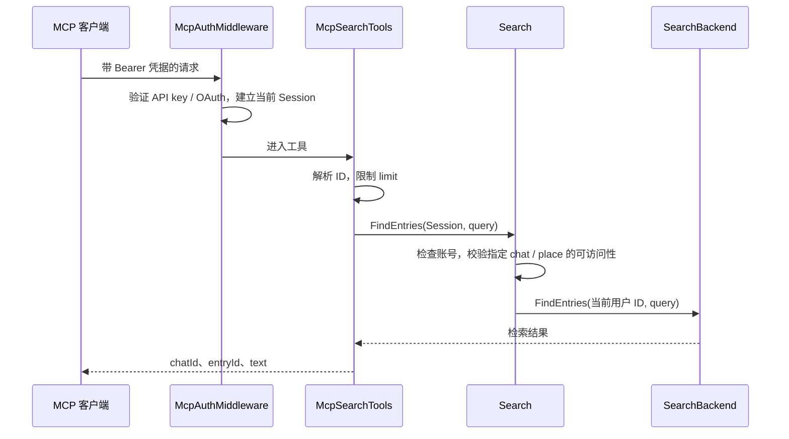

# 第 4 课：MCP 提供工具，Agent 决定怎样使用

## 这一课的目标

读懂一条工具调用的身份、参数、业务调用与返回结果，知道还缺哪些部分才能组成自己的 Agent。

## 1. 本仓库已经提供什么

[McpModule](../../../src/dotnet/Mcp/Module/McpModule.cs) 在 API host 且配置了 route 时注册 MCP 服务，使用无状态 HTTP transport，并显式注册消息、聊天、账号、检索等工具类。

`[McpServerTool]` 定义工具名，参数的 `Description` 告诉调用者如何填写，`UseStructuredContent` 请求结构化结果。工具描述也是模型理解接口的一部分，但不会自动成为权限检查。

按当前源码可确认它是 **MCP server**。外部客户端连接它，不意味着产品内部必然存在一个自主规划 Agent。

## 2. 追踪 search_messages

入口：[McpSearchTools.SearchMessages](../../../src/dotnet/Mcp/Tools/McpSearchTools.cs)（基线约 26 行）。

以下是教学参数对象，不是完整的 MCP JSON-RPC 报文，也未执行：

```json
{
  "query": "发布计划",
  "chatId": null,
  "placeId": null,
  "limit": 20
}
```

调用链：



继续阅读 [Search](../../../src/dotnet/MLSearch.Service/Search.cs) 与 [SearchBackend](../../../src/dotnet/MLSearch.Service/SearchBackend.cs)。工具不直接接受“相信我，我是这个 userId”作为身份；身份来自经验证的请求。

`ISearch` 按功能设置注册。工具采用延迟解析，使搜索未启用时其他工具仍可工作；这不代表搜索工具在关闭检索时一定返回正常结果。

## 3. 认证和授权是两道边界

[McpAuthMiddleware](../../../src/dotnet/Mcp/Auth/McpAuthMiddleware.cs)：

- API key 路径验证 Session 存在、有效，且已绑定非访客用户。
- 其他 Bearer token 委托给 OAuth 认证器。
- 失败返回 401；成功把 Session 放进当前 `HttpContext`。

[McpSessionAccessor](../../../src/dotnet/Mcp/Auth/McpSessionAccessor.cs) 从当前 HTTP 请求提取身份。虽然 accessor 注册为 singleton，也没有把某个用户的 Session 固定保存在全局字段。

认证成功之后，`IChats`、`ISearch` 等业务服务仍须验证资源权限。工具本身的“描述写着允许/禁止”不能替代这些检查。

工具列表也不等于授权列表。例如 [McpDatabaseTools](../../../src/dotnet/Mcp/Tools/McpDatabaseTools.cs) 注册了数据库工具，但其调用经过 [MuiDb.RequireAdmin](../../../src/dotnet/Mui/Services/MuiDb.cs) 的管理员校验。本次未审计完整 SQL 执行防护，不能只凭工具描述宣称任意 SQL 都安全。

MCP 官方规范分别定义工具调用与 HTTP 授权。工具注解属于提示信息，不是服务端的访问控制；客户端也应提供清晰的调用可见性及适当的人为控制。[工具规范](https://modelcontextprotocol.io/specification/2025-06-18/server/tools)、[授权规范](https://modelcontextprotocol.io/specification/2025-06-18/basic/authorization)

## 4. 写工具更需要明确副作用

[McpMessageTools.PostMessage](../../../src/dotnet/Mcp/Tools/McpMessageTools.cs)：

1. 解析 chat / media ID。
2. 创建带当前 Session 的 `Chats_UpsertEntry`。
3. 交给 Commander，返回新消息 LocalId。

这是实际业务写入。学习时先使用只读工具或模拟工具，不直接拿生产聊天测试。

这里每次调用都会新建命令；对同一个 MCP 请求的应用层重试是否避免重复消息，必须单独验证。项目的 [命令去重机制](../../../docs/architecture/command-idempotency.md) 采用进程内存储，并有跨节点 / 重启边界；它不能被当作所有工具调用的持久化恰好一次保证。

## 5. 错误应既可修正，又不过度泄露

[McpToolErrorFilter](../../../src/dotnet/Mcp/Module/McpToolErrorFilter.cs) 将部分调用者错误转换为可见的 `McpException`，其余异常继续交由 SDK 处理。

模型若只看到“失败”，可能反复使用错误参数；明确的格式、权限或冲突信息有助于纠正。但异常消息本身仍需检查是否包含内部数据，不能仅凭异常类型就认定内容一定适合公开。

## 6. 离完整 Agent 还差什么

本次在 `src` / `tests` 的 C#、TypeScript 中搜索了 `FunctionChoiceBehavior`、`ToolCallBehavior`、`FunctionCallContent`、`AIFunction`、`ChatCompletionAgent`、`AgentGroupChat`、`FunctionInvokingChatClient`、`tool_use`、`tool_result`，未找到这些模式的实现。

这是有范围的搜索结论，不是对所有语言、外部部署或未来代码的不存在证明。依赖文件虽声明 Semantic Kernel Agents 包版本，声明包版本本身不能证明存在 Agent 循环。

自己的 Agent 还需要：

```text
用户目标
  → 组织上下文与允许的工具
  → 模型给出最终回答，或请求工具
  → 运行时验证工具名、参数、权限、预算
  → 执行工具，将结果交回模型
  → 检查停止条件，继续或结束
```

循环中的模型输出只是请求；是否执行由运行时和业务服务决定。第 7 课的练习 C 会把这部分作为新能力，而不是假设仓库已经具备。

## 理解检查

1. 为什么工具能出现在列表里，却仍然可能拒绝当前用户？
2. `Session` 为什么不应由模型自由选择？
3. 如何区分“工具返回异常”和“模型没有成功完成用户目标”？
