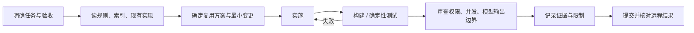

# 第 6 课：如何学习仓库的 AI 编程协作

## 这一课的目标

理解开发团队怎样给编码 Agent 提供约束、工具流程和反馈，并识别规则文件自身可能过时的地方。
本课把技能文件当作分析材料，不表示已执行 review、create-pr 或发布到团队聊天。

## 1. 三种不同的“工作流”

| 层次 | 例子 | 用途 |
|---|---|---|
| 产品运行时 Workflow | `Flow`、摘要调度 | 产品处理用户数据 |
| 编码 Agent 工作步骤 | 技能中的阅读、实现、检查、审查 | 协助工程师改代码 |
| 自动化流水线 | GitHub Actions、构建、测试 | 用工具验证和发布代码 |

它们可以协作，但不是同一套运行时。一个 `SKILL.md` 也不会自动变成具备数据库恢复机制的 Flow。

## 2. 规则解决“项目特有约定”

根 [AGENTS.md](../../../AGENTS.md) 强制先读编码风格和类型索引。
重要的不只是格式，而是避免模型按熟悉的其他项目习惯复制一套新抽象。

这里异步方法命名、注释规则、序列化、等待辅助方法、迁移生成都有项目约束。
修改规则应编辑 `AGENTS-Source.md` 等来源后再生成，不直接修改自动生成的 AGENTS.md。

可以迁移到自己项目的做法是：明确入口、约束、验证命令和例外处理。不要把整份规则原样复制到技术栈不同的仓库。

## 3. Hook 把一部分约定变成检查

[.claude/settings.json](../../../.claude/settings.json) 配置了 `PostToolUse` 的 `Write|Edit` Hook：

1. Node 脚本检查机械风格。
2. Agent Hook 检查剩余风格规则。

[style-check.mjs](../../../.claude/hooks/style-check/style-check.mjs) 会判断文件后缀、计算改动附近行，并把发现写回工具上下文。

这是“确定性检查 + 模型审查”的分工。机械检查适合精确可判定的规则，模型审查适合需要语境的判断；两者仍不等于业务正确性测试。

**不要过度推断：** `.claude` 中配置了 Hook，不代表当前 Codex 会话、普通编辑器和 CI 都自动执行了它。本轮只改 Markdown，没有运行这些源码风格检查，也没有以 Hook 是否报错来证明产品正确。

## 4. 技能需要像代码一样维护

阅读 [review 技能](../../../.agents/skills/review/SKILL.md) 和 [checklist](../../../.agents/skills/review/checklist.md)，可以学习 SQL、安全边界、条件副作用、测试缺口等审查维度。

同时本地可见两处需要核实的适配问题：

- 技能正文引用 `.Codex/skills/review/checklist.md`，而本次找到的实际清单在 `.agents/skills/review/checklist.md`。
- 清单含 Rails / Ruby 特定例子，如 Arel、`update_all`、`html_safe`。它们表达的风险可能适用，但不能照字面套到 C# / EF Core。

本轮没有修改技能。可学习的经验是：技能也有路径依赖、技术栈依赖和版本漂移，不能因为文件叫“best practices”就视为正确。

## 5. 从任务到验证的闭环

在自己的项目中，先建立短而可靠的这条闭环，再决定是否需要更多 Agent。更多角色不自动提高质量，重复阅读相同上下文也有成本。

`track-issue` 会操作原作者的 issue 和看板，`create-pr` 还包含团队通知步骤。个人 fork 的学习归档不应自动扩大成上游协作或生产消息。当前仅保存并同步个人学习分支，不创建 PR，也不运行 prepare-merge。

## 6. CI 也要看实际触发条件

[build-test-deploy-dev.yml](../../../.github/workflows/build-test-deploy-dev.yml) 的 push 触发限制到 `master`、`dev`、`release/v*`，并忽略 Markdown 变更。

所以本学习分支成功推送，不代表该工作流运行或通过。本次使用文档链接与 Git 范围检查验证交付，不把“没有 CI 失败”当作产品测试通过。

## 可以直接复用的任务提示词

> 先阅读仓库规则和现有抽象，追踪一条具体业务调用链。说明输入、输出、权限、状态和副作用。修改前列出复用对象和验收标准；用最小变更实现。分别验证确定性业务规则、外部服务失败和模型输出质量。报告实际执行的检查、未验证的部分与提交范围。将计划、证据和结论归档，避免只存在于聊天记录。

这是任务组织模板，不授权任何生产写入或上游发布。

## 理解检查

1. 为什么需要把风格检查、业务测试和模型评估分开？
2. 为什么 `.claude/settings.json` 的存在不能证明当前编辑一定经过 Hook？
3. 发现技能里的路径或技术栈不一致时，为什么应先核实而不是照着执行？
